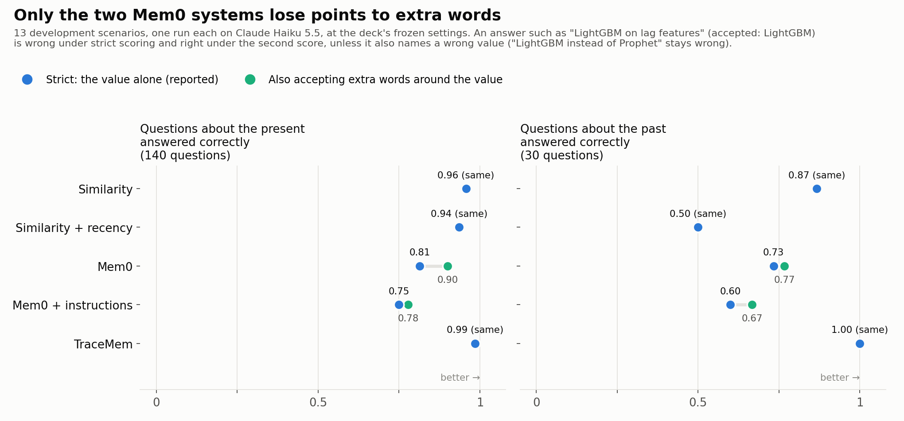

# 0015. Report a second score that accepts extra words around the value, beside the strict score

## Context

The scorer accepts an answer only when the answer's value field holds an accepted value and nothing else ([`docs/metrics.md`](../metrics.md), section 1: "The field must hold only the value."). In the A7 run on Claude Haiku (13 development scenarios, the deck's frozen settings, one run per system), 19 answers added words around a correct value. For example, Mem0 gave the value "LightGBM on lag features" where the accepted value is LightGBM. All 19 answers came from the two Mem0 systems: 13 from Mem0 and 6 from Mem0 + instructions. The other three systems gave no such answer. Mem0 stores each memory as a short phrase, and the answering model copied that phrase into the value field. Strict scoring counts these 19 answers as wrong values. Part of the gap between the Mem0 systems and the other three is therefore a matter of format, not of memory.

## Decision

1. Strict scoring stays the reported score. The scorer (`src/tracemem/eval/classify.py`) and `docs/metrics.md` do not change.
2. The deck and the report show a second score beside the strict one, for questions about the present and questions about the past. The second score also counts an answer as correct when all four of these conditions hold:
   - The strict scorer labelled the answer `wrong_other`.
   - The question has a settled value. A question whose answer is "nothing settled" or a dispute is left as the strict scorer labelled it.
   - The value contains an accepted value as whole words. "DistilBERT" does not count as containing BERT.
   - The value names no replaced value, no suggestion, no other item's value and no value that is current when the question asks about the past. "LightGBM instead of Prophet" therefore stays wrong.
3. `scripts/contains_scores.py` computes the second score from each run's saved answers. The rule is in `src/tracemem/eval/contains.py` and its tests are in `tests/test_contains_scores.py`. The script calls no model and costs nothing. Its `--list` option prints every answer that the second score re-labelled, so a reader can check each one.
4. The rule is fixed on 27 Oct 2026, before any of the deck's test answers exist. Nobody can therefore choose the rule after seeing which system it helps.

## What the second score changes on the development scenarios

The figure and the table use the A7 run on Claude Haiku at the deck's frozen settings: 13 development scenarios, one run per system. The figure is drawn from the same saved answers with the same rule.

| System | Present, strict | Present, second score | Past, strict | Past, second score | Answers re-labelled |
|---|---|---|---|---|---|
| Similarity | 0.96 | 0.96 | 0.87 | 0.87 | 0 |
| Similarity + recency | 0.94 | 0.94 | 0.50 | 0.50 | 0 |
| Mem0 | 0.81 | 0.90 | 0.73 | 0.77 | 13 |
| Mem0 + instructions | 0.75 | 0.78 | 0.60 | 0.67 | 6 |
| TraceMem | 0.99 | 0.99 | 1.00 | 1.00 | 0 |

The present column counts 140 questions and the past column 30. The order of the five systems is the same under both scores. On questions about the present, the gap between similarity and Mem0 falls from 0.14 under strict scoring to 0.06 under the second score.

## Consequences

- A reader can see how much of a system's score is lost to the format of its answers rather than to what its memory holds.
- The second score is cautious. An answer that names a wrong value beside the right one stays wrong, even when the system meant the right one.
- The second score changes only accuracy. The error rates, such as the rate of suggestions given as decisions, keep the strict labels.
- The team should revisit this record if an answer that the second score accepts turns out to be wrong on inspection, or if a system other than the two Mem0 systems starts adding words around its values.
