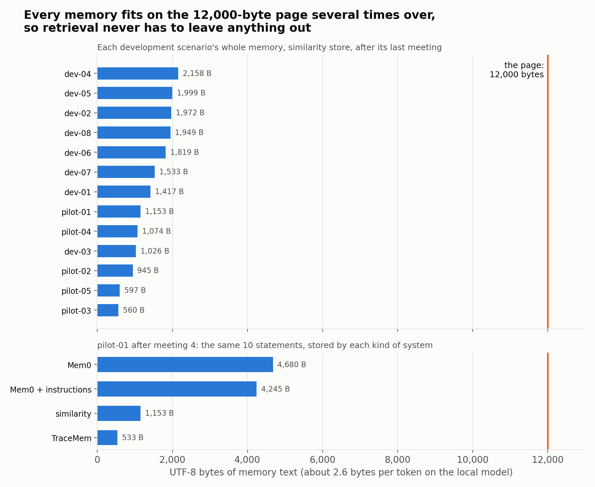
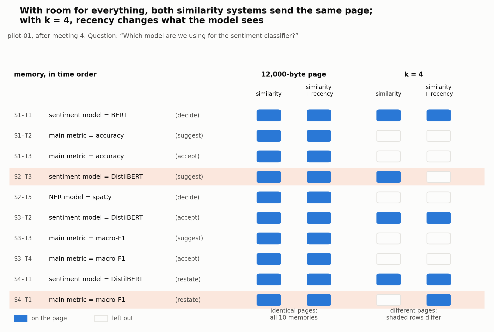
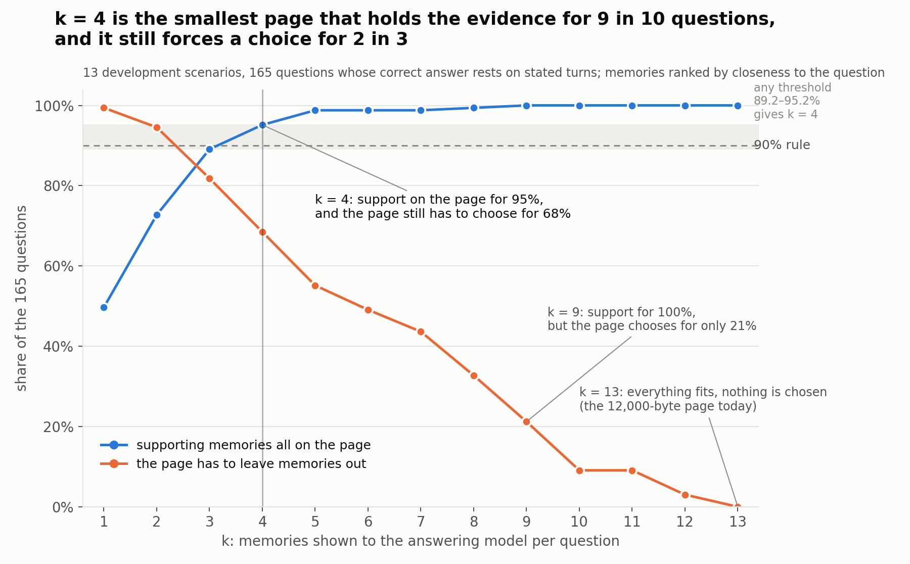
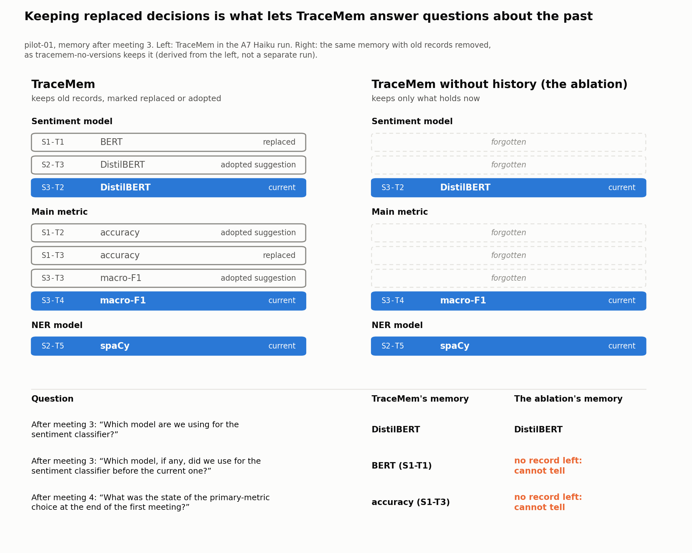

# Controlled memory comparison

Five registered systems compare memory management after extraction, and a sixth,
`tracemem-no-versions`, remains registered as a diagnostic ablation. They accept
only `--condition gold_candidates`; they never receive the gold timeline, expected
answers, script acts or question-to-item mapping. This is a component experiment,
not an end-to-end comparison of the products.

| System | Write path | Retained memory | Retriever |
|---|---|---|---|
| `similarity` | None | Every candidate as one record without a status | Similarity to the question (`alpha=0`) |
| `similarity-recency` | None | The same | Similarity and recency (`alpha=0.3`, 7-day half-life, provisional) |
| `mem0-classic` | Pinned native Mem0 ADD/UPDATE/DELETE/NONE engine | Current native memories and all native history events, including updates and deletes | Recency alone (`alpha=1`) |
| `mem0-instructions` | The same engine, with the project rules after Mem0's default update prompt | The same | Recency alone |
| `tracemem-controlled` | `LLMResolver` and `OpLog` | Current records, closed records, statuses, sources and supersession links | Recency alone |
| `tracemem-no-versions` (diagnostic) | Same resolver, prompt and operation validation | Active, proposed and contested records with sources; closed records and supersession links discarded | Recency alone |

The ablation removes retained versions, not the resolver, proposal/conflict handling
or provenance. Its operation audit exists for offline scoring only: neither matching
nor answering can reconstruct closed versions from it. Live-state behavior is
checked against `OpLog` on every development pilot. As rollouts diverge, the same
resolver naturally sees different retained records.

## Why Mem0 classic 1.0.11

This baseline pins [`mem0ai==1.0.11`](https://pypi.org/project/mem0ai/1.0.11/), the
classic ADD/UPDATE/DELETE path discussed in the proposal feedback. Mem0 2.x changed
to an ADD-only design; this name does not claim to evaluate the latest Mem0 release.
The corresponding [native implementation](https://github.com/mem0ai/mem0/blob/144627c4ce5bc4db6acac17cbd158065f2b27a8d/mem0/memory/main.py)
is called directly, not reimplemented as a TraceMem resolver. The adapter refuses
other installed versions.

Mem0 already has native change history. That history is included in its read context;
a difference on historical questions cannot be attributed simply to denying Mem0
its history. TraceMem's proposed contribution is explicit decision status and
supersession semantics. Measure that claim rather than assuming every update is an
innovation over Mem0.

The adapter deliberately controls three SDK dependencies:

- Extraction returns the supplied candidate unchanged as one JSON fact, including
  its quote, speaker, item and sources. It makes no extraction model call.
  `Memory.add(infer=True)` still executes the SDK's stock update prompt, identifier
  mapping, mutation methods and SQLite history. `infer=False` would bypass the
  update engine too, so it is not used.
- Matching supplies all current memories for the candidate's item, bypassing the
  SDK's vector ranking and fixed top-five limit. The two TraceMem arms also match
  all retained records for that item. Differences in retained memory are part of
  the experiment; retrieval recall is controlled.
- The injected model bridge uses the same `CompletionClient` and `ResolverConfig`
  as TraceMem. No default SDK model, embedding service, external database or
  telemetry is used. Native update prompting remains Mem0's own algorithm.

Initialization injects dependencies through a pinned internal SDK seam. Offline
tests exercise the actual installed SDK, including update/delete history and
partial-write rollback; an SDK upgrade requires reviewing that seam and repinning.

## Mem0 with project instructions

`mem0-instructions` is `mem0-classic` with one change. Its update prompt is the SDK's
own default update prompt, read from the installed package, followed by a blank line
and `PROJECT_RULES` from [`mem0_baseline.py`](../src/tracemem/systems/mem0_baseline.py).
The SDK's `get_update_memory_messages` puts a custom update prompt where its default
would stand, at the head of the update request; the memories, the new facts and the
required output format follow unchanged. Mem0 1.0.11 reads that prompt from its
`MemoryConfig` (`custom_update_memory_prompt`), not from the attribute of the same
name, so the adapter sets both. An offline test checks that the request is exactly
the classic request with the rules after the default prompt, and that `mem0-classic`
still sends the default alone.

After a first line saying how to apply them with Mem0's four operations, the rules are
passages copied from the Resolver's `INTENT_GUIDE`:

- a suggestion is not a decision (items 1 and 2);
- a dispute stays open until someone settles it (item 4);
- a statement about another item never replaces this one (item 1's "Do not transfer…"
  and the tagging example);
- a replaced decision is kept as the previous version (the example that retains X as
  the previous active version).

No code enforces them. The update model alone applies them, with ADD, UPDATE, DELETE
and NONE, and the adapter validates and applies its actions exactly as for
`mem0-classic`. `system_config.backend` records `update_prompt_hash`, the hash of the
whole update request with no memories and no facts, which therefore differs between
the two Mem0 systems, and `instructions_hash`, the hash of the rules (`null` for
`mem0-classic`).

## Similarity systems without a write path

`similarity` and `similarity-recency` make no model call while observing. Each keeps
every candidate it receives and, for each question, builds its store with
`ops.flat_records`: one record per candidate, with the candidate's item, value,
speaker and source turn, and no status. Nothing is merged, replaced or discarded, so
`usage.json` reports no write calls and there are no operations to score. For an
as-of question they read all retained records, as Mem0 does; only TraceMem projects
its operation log to the requested session.

Their store is the candidate text itself, so each context line is the shared line
plus the quoted text of the record's first source turn, exactly as `render_records`
writes it when given the turns. For pilot-01's S2-T3 ('Maybe we could try DistilBERT?'):

```text
S2-T3 Arun: model.sentiment = DistilBERT "Maybe we could try DistilBERT? It might be faster." | sources=S2-T3
```

The quote is part of the line that the retriever embeds and the byte budget counts.
The other arms keep the line without it (see below). Each manifest records which
form a system uses as `system_config.quote_source_turns`. The shared `context_format`,
now `shared_record_renderer_with_sources_v2`, no longer states that no arm sees
dialogue; runs made before this change cannot be reported with runs made after it.

The two systems differ only in their retriever. `similarity` ranks records by
similarity to the question alone; `similarity-recency` mixes in recency, with the
age measured to the latest observed turn, including turns without candidates. Its
weight and half-life are provisional.

On every current development scenario, the default 12,000-byte budget holds all of a
similarity system's records: the largest store, pilot-01's, takes 1,153 bytes. The
retriever then drops nothing, and since the selection is shown in time order, its
ranking has no effect. `similarity` and `similarity-recency` therefore select the
same records and send identical requests on these scenarios, so their answers can
differ only through model variation; when they share a reply cache, the second
system replays the first one's replies. Their results on these scenarios are one
result, not a comparison of retrievers. The weight and half-life can matter only
when a store is larger than the budget, through longer scenarios or a smaller budget
for every arm.

For that reason the comparison runs with a fixed number of records per answer,
`TRACEMEM_CONTEXT_TOP_K` ([decision 0011](decisions/0011-compare-five-memory-systems.md),
question 4): every system shows the answering model the `k` records closest to the
question, and `similarity-recency` adds recency. Mem0 and TraceMem then rank by
similarity too, instead of newest first. `k = 4` on the development scenarios of
26 Oct, chosen by `scripts/choose_top_k.py`; set it for every system of a run, or
the runs cannot be reported together. The limit applies to questions about the
present only. A question about the past (`previous` or `as_of`) is shown every
record that fits the byte budget, closest first; when the budget still leaves
records out, its context ends with a line such as "8 of 11 records shown; 3 left
out to fit the context budget." and that question alone gets a rule to abstain
rather than answer none ([decision 0016](decisions/0016-show-history-questions-every-record-that-fits.md)).

## Shared inputs and answering

All arms use the same candidate list, explicit model, optional temperature,
output limit, timeout and retry limit. They share one model client, chosen by
`TRACEMEM_PROVIDER`: the built-in OpenAI transport and fixed endpoint by default, or
OpenRouter or a local Ollama server ([local model guide](local-model.md)), always with
the same reply cache and spending cap; no seed is set. The same configuration also controls
answer calls. The model must support the existing structured-answer
transport. Candidate hashes, configuration, the model client's reply-changing
settings (provider, endpoint, thinking switch, output-limit field and, for a local
server, the model's context and digest; never the key, the cache or the cost log),
reference resolver prompt/schema hashes, answer prompt/schema hashes,
answer-validation policy hash and temporal reader policy are recorded in
`manifest.json`.

The shared reader considers all retained records without a gold question-item
filter. For an as-of question, TraceMem first projects its own applied operation
log through the last observed turn in the requested session, using the existing
`OpLog.upto` interface. The session comes from the public question; neither a gold
item nor an expected state is used. An invalid or unobserved session produces an
empty versioned context, rather than falling back to today's state. Current and
previous questions continue to use all retained records. The no-version ablation
does not replay its scoring audit; Mem0 continues to supply its native retained
memories and history.

Every arm then selects entries with the same shared retriever (see
[below](#shared-retriever-and-answer-conventions)). The TraceMem and Mem0 arms rank by
recency alone, so the retriever chooses newest entries first. For every arm it includes
only complete entries within `TRACEMEM_CONTEXT_BUDGET_BYTES` (default 12,000 UTF-8
bytes) and renders the selected entries chronologically using the same record renderer. This is a byte budget,
not the pipeline's `budget_tokens` estimate or a guarantee of equal token counts.
Native Mem0 history is rendered as before/after events without inventing TraceMem
statuses. All arms use the identical answer prompt, output schema and citation
validation. For the TraceMem and Mem0 arms, only retained memory and source IDs
reach the answer model; raw dialogue is not appended, because it could restore
discarded versions. Mem0 may retain candidate quotes inside its native memory text;
those remain legitimate stored evidence, rather than an extra transcript supplied at
read time. The similarity arms discard nothing and store the candidate text itself,
so their lines quote each record's own source turn (see
[above](#similarity-systems-without-a-write-path)).
The shared renderer shows values, statuses, creation turns, speakers and sources;
it does not serialize raw record IDs or supersession edge IDs. TraceMem's edges
remain available to its resolver, while answering uses the retained versions and
their chronology/statuses.

### Shared retriever and answer conventions

Every system that answers through `SharedAnswerer` selects its context with one
retriever, `SharedRetriever` in [`retrieval.py`](../src/tracemem/retrieval.py), so
their context selection can differ only in its two settings. Each entry scores
`(1 - alpha) * cosine(question, entry) + alpha * recency`, where
`recency = 0.5 ** (age_days / half_life_days)` and the age runs from the entry's
`created_at` to the latest observed turn. An entry's text is its context line, exactly
as the answer model reads it. Entries are taken in descending score, newest first
among equal scores, while they fit the byte budget; each costs its line's UTF-8 bytes,
plus one for the newline before it unless it is the first selected, and a line that
does not fit is skipped whole. The selection is shown in time order. Embeddings come
from the local server's OpenAI-compatible `/v1/embeddings` endpoint
(`TRACEMEM_LOCAL_BASE_URL`, model `TRACEMEM_EMBED_MODEL`, default `nomic-embed-text`
with its `search_query: ` and `search_document: ` prefixes) and are saved under
`cache/emb/`, keyed by model and text, so each text is embedded once.

`similarity` uses `alpha=0` and `similarity-recency` uses `alpha=0.3` with
`half_life_days=7`. The TraceMem and Mem0 arms use `alpha=1`. Recency then falls
strictly with age, so the ranking is the time order itself: the retriever makes no embedding call and selects
exactly the entries the earlier newest-first code chose, ties included (newest first
by creation time, creating turn, item, value and record ID). Offline tests check this
on every record set in the saved fixtures and on each pilot's gold store, at several
budgets.

Each manifest splits the retriever's settings in two. Systems may differ in `alpha`
and `half_life_days`, so these, the ranking they give and the embedder a system
actually calls are recorded under `system_config.shared_retriever`. Everything else
must be equal and is recorded under `comparison.retriever`: the selection policy,
how age is measured, the document text and the embedding model with its prefixes.
A system that ranks by recency alone makes no embedding call, so it records the model
`TRACEMEM_EMBED_MODEL` selects, the one a similarity system run alongside it uses.
`tracemem report` therefore refuses to compare runs embedded with different models
or selected under a different policy.

The shared answer prompt also states, in one paragraph (`ANSWER_CONVENTIONS`), the
labelling conventions of [benchmark section 5](benchmark.md#5-labelling-conventions-for-hard-cases)
that decide answers, in the parts the prompt did not already say: a turn that states a
choice without hedging is a decision, even when nobody replies; function decides
between a suggestion and a mention; a dispute stays open until someone settles it;
on a decision, a turn that adopts the value of an earlier open suggestion accepts it,
even when it gives reasons of its own, and the suggestion's turn is part of the
evidence; announced progress counts when it changes the progress. All arms receive the
paragraph. It changes `answer_prompt_hash`, so `tracemem report` refuses
to compare runs made before and after it; rerun every arm. The output schema,
renderer, validator, model settings and Resolver fingerprints are unchanged.

### Current validation and historical reads

[Decision 0010](decisions/0010-validate-reader-evidence-and-historical-state.md)
adds bounded semantic checks to the shared answerer. Structural validation still
requires complete answer JSON, consistent status/value, and unique citations from
the supplied context. The new checks use exactly the records selected for that
context, not the full store, raw dialogue, hidden supersession edges or gold.

A settled answer can be checked only when its value exactly matches one visible
active record. If several active records share the value, or no active record
matches, code does not infer the question's item. For current/as-of answers, a
visible contested record for the matched item rejects the definite answer. An
as-of check excludes records created after the requested session. Projection of
TraceMem's actual log supplies the old statuses and excludes later KEEP sources:
a claim declined today can still be contested in an earlier snapshot. A current
declined record by itself does not reveal when the dispute was resolved.

For a current settled answer with no such dispute, a visible earlier superseded
record of the same item and value establishes a linked origin only when its
creating turn is listed in both its own sources and the active record's sources.
Earlier means an earlier numeric session/turn position in the displayed creating
turn, not an unrendered `created_at` timestamp; unparseable positions are skipped.
The active creating turn must also be among its sources. The answer must cite
that origin and the active creating decision; a later reaffirmation does not
replace either role. This does not classify the earlier record as a proposal:
`superseded` alone cannot reveal its former status. An open proposal, an unrelated
item, an unlinked old record, or an origin omitted by the byte budget does not
create that requirement. The checks enforce required roles, not exact citation
minimality, and do not validate all previous-value or native-text semantics.

Rejected replies receive bounded feedback within the existing `max_attempts`.
Feedback repeats only validation requirements and visible source IDs, never raw
rejected replies or new evidence. Displayed source lists contain at most 12 IDs
of at most 64 characters each. An oversized ID is omitted whole, never shortened
into an invented source ID; validation still uses the full required set. The model
must emit a complete replacement reply. Code does not add citations, replace the
answer with a computed value, or force a conflict reply. Exhaustion returns
`abstain`; all attempted calls and reported tokens remain in answer usage.

All arms share this validator, prompt, schema, model configuration, context
budget and retry limit. Native Mem0 has no explicit TraceMem statuses, so the new
status-based guards do not fabricate them from native UPDATE/DELETE events.
Interpreting native evidence remains the shared model's responsibility. Additional
calls arise only when validation or generation fails; valid replies still use one
request. This changes reader behavior, not Resolver decisions or stored memory.

The manifest records `answer_validation_policy_hash`, reader
`retained_memory_asof_oplog_snapshot_whole_entries_v2`, and
`temporal_read_policy=observed_session_oplog_prefix_other_stores_retained_only_v1`.
The shared answer prompt also clarifies that the first current checkpoint after
adoption and later KEEP confirmations still require both visible evidence roles,
so `answer_prompt_hash` changes. The output schema, renderer, model settings and
Resolver fingerprints are unchanged. Comparisons must track the new read policies
and prompt rather than attribute later improvements to a Resolver-only change.

`tests/fixtures/reader_provenance_temporal_failures.json` preserves actual dev
replies that omitted the DistilBERT or accuracy origin and that answered an old
dispute as settled. Offline regressions replay those responses, require feedback
or safe exhaustion, and test complete corrections. The temporal tests reproduce
FLAG followed by KEEP using actual operation semantics, test read-only snapshots
and budgets, and prove that the no-version audit cannot restore history. These
tests establish enforcement and integration, not live-model improvement. This
repair uses offline checks only; the next real development experiment must report
answer retries, abstentions, citation completeness and historical accuracy beside
the unchanged Resolver adoption and control cases.

### Earlier policy changes

The following paragraphs describe the individual changes in decisions 0005-0009.
Their statements about unchanged runtime validation and structurally legal bad
answers apply to those earlier versions. Decision 0010 above adds executable
checks; earlier run artifacts and decision records remain unchanged.

The shared answer prompt includes `ANSWER_STATE_GUIDE`. For current questions,
record status and domain value are separate: `cancelled [active]` means cancellation
is the settled state, while `open [proposed]` is only an option. A different or newer
proposal does not produce a conflict or replace the active value. Relevant contested
evidence still means a genuine unresolved dispute; unrelated items and closed history
do not. An explicitly adopted reopening can become the active value normally.
Task answer `value` contains only the task value, with qualifications in `text`.

Previous/as-of questions use retained evidence at the requested time rather than
today's active record. A proposal does not establish a settled historical version.
If the byte budget omits a necessary active or historical record, the answerer must
not reconstruct it from an audit or promote the remaining proposal. Insufficient
evidence permits abstention. Native Mem0 text/events are interpreted without adding
TraceMem statuses; an SDK UPDATE is not itself proof of a human decision.

In decision 0005 this guide was shared unchanged across all three arms. The renderer,
selection budget, four-field output schema and normal one-request flow stayed the same.
That change updated `answer_prompt_hash`, independently of the Resolver prompt and
policy fingerprints. Old and new runs therefore have different shared answer
policies and must not be presented as a pure Resolver-only intervention. That version
had no keyword override or automatic replacement of a structurally valid bad answer.
The saved reopening regressions test request assembly and scripted state effects;
live semantic improvement requires a new development run. See
[decision 0005](decisions/0005-interpret-task-reopening.md).

The subsequent affirmative-selection repair in
[decision 0006](decisions/0006-recognize-affirmative-selections.md) changes only the
Resolver intent prompt and policy. Relative to the reopening-policy run, its
`answer_prompt_hash`, reader, schemas and model settings stay the same. Both
TraceMem arms receive the revised Resolver; Mem0 keeps its native write policy.
Compare declared Resolver fingerprint changes explicitly rather than rewriting
old manifests. Fixed configuration still does not remove model-output variation.
The offline regression chain checks retained predecessors after a correct initial
selection; it does not retrofit history into earlier incorrect runs or establish
that live current/historical accuracy has improved.

The later evidence repair in
[decision 0007](decisions/0007-preserve-adoption-and-history-evidence.md) adds a shared
`ANSWER_CITATION_GUIDE`. For a previous-value question, cite evidence establishing
the earlier settled value and the replacement that made it previous. A later KEEP
confirmation cannot substitute for the replacement event; copying every source is
not the objective. For an as-of question, use evidence establishing the state by
the requested time and do not require a later replacement. Current answers still
cite the current settled state; a reopening proposal is not evidence of a conflict.
The rule applies equally to relevant Mem0 native before/after evidence. It does not
require two distinct IDs when a single retained source supports the whole answer.

Only sources present in the supplied, budget-limited context may be cited. Neither
an item name nor a source ID shared with another item recovers a missing historical
fact. If needed evidence is absent, abstain or explain the limitation rather than
inventing a historical value, event or citation. The renderer, budget and four-field
schema were unchanged in decision 0007. Citation validation then checked uniqueness
and membership in supplied sources, not semantic completeness; code did not fill
citations using TraceMem-only edges, raw dialogue or benchmark gold.

`tests/fixtures/historical_citation_failures.json` captures the real development
answer that identified logistic regression correctly but cited only its initial
selection, omitting the SVM replacement. The offline tests preserve this structurally
valid incomplete reply, then check a scripted complete reply, as-of boundaries,
current cancellation, missing/truncated evidence, current-only abstention and native
Mem0 history under the same prompt. They do not prove live citation improvement.
The executable adoption-source guard and the suggestion/dispute prompt correction
also change the Resolver fingerprints in this round. Therefore the next comparison
changes both write and shared read policies: both Resolver arms get the write repair,
and all three arms, including Mem0, get the reader repair. Report write and answer
metrics separately and do not attribute the whole difference to Resolver alone.

The follow-up in
[decision 0008](decisions/0008-constrain-adoption-and-answer-evidence.md) adds a final
`ANSWER_EVIDENCE_CHECK` to the same shared prompt. Required evidence must appear in
`cited_turn_ids`, not only in explanatory text. PREVIOUS keeps both the earlier
settled choice and its formal replacement, rather than substituting a later KEEP.
CURRENT keeps the settled decision and a visibly linked origin when preserved.
For explicit-status records, a closed same-item/same-value origin whose creating
turn appears in the settled record's sources supplies provenance. This does not
infer that the closed record used to be proposed: `superseded` alone does not
reveal its former status. Native memory requires equivalent explicit text/history.
The origin supports what was adopted; the adoption supports approval. An open
same-value proposal is not evidence of acceptance. Citation roles depend on the
question and answer status; a predecessor excluded from a current settled answer
can be essential to a previous answer, and conflict needs competing evidence.

Only visible content can establish those roles. A source ID alone does not recover
a discarded proposal or predecessor. When the current value is supported but its
origin is missing, answer only that supported value without inventing an adoption;
abstain when essential historical content is unavailable. In decision 0008 the
renderer, budget, output schema and runtime citation validation stayed unchanged.
That was a prompt repair, without semantic validation or automatic citation
completion. All three arms received the same instruction without extra model calls.

`tests/fixtures/answer_evidence_failures.json` captures the subsequent LR-to-SVM
historical omission and DistilBERT current-origin omission from the real dev run.
At that stage offline regressions reconstructed their exact visible contexts and
retained the bad replies as structurally valid controls, then exercised complete
answers.
They cover previous/current distinctions, as-of boundaries, disputes, cancellation
with proposed reopening, unadopted same-value proposals, missing/truncated history,
current-only memory and native Mem0 evidence. Real-model improvement still needs
a new run. This round changes Resolver prompt/policy and shared answer-prompt
fingerprints; model settings, schemas and the candidate protocol stay fixed.

The following repair in
[decision 0009](decisions/0009-preserve-adoption-during-source-retries.md) puts state
selection before evidence pruning. For a current question, a relevant unresolved
contested claim requires `conflict` with a null value and visible dispute evidence.
An active record does not establish that the dispute was resolved, and a contested
claim is not merely a proposal that failed to win approval. The final evidence check
applies its settled-current citation rule only after `status=answer` is justified.
Different-item disputes, closed claims and reopening proposals do not establish a
current conflict. Previous/as-of questions still require historical evidence and
must not project today's dispute or resolution back in time.

All three arms receive this prompt. Native Mem0 entries use explicit unresolved
disagreement in retained text/history, without fabricated TraceMem status labels.
In decision 0009 no semantic override, extra model call, hidden question item, gold
state or restored history entered the answer path. The renderer, budget, schema
and runtime citation validator stayed unchanged. That repair changed the shared
instruction without adding executable semantic checks.

`tests/fixtures/answer_conflict_failures.json` preserves the two actual current
training-dataset replies that selected IMDB despite a visible unresolved SST-2
claim. Offline tests replay the saved operations and exactly reconstruct each
request. At that stage the captured wrong replies remained structurally valid
controls; scripted conflict replies tested the contract and prompt routing.
Boundary cases retain the distinction between real disputes, proposals, adopted restarts and historical
questions, including native memory and partial context. LR-to-SVM history and
adoption-origin citation regressions remain enabled. A real-model rerun is still
needed to measure conflict accuracy; it must separate reader effects from the
simultaneous Resolver source-retry repair and count exhausted writes explicitly.

`tracemem report` refuses controlled comparisons with different protocol settings,
model client settings or candidate hashes, even with `--allow-mixed`. Ordinary
checks for scenario files, split and condition still apply. Shared settings must
also stay constant across scenarios within one run. Every scenario gets a fresh
store, and the harness closes native resources after collecting its results.

## Run and inspect

Install the optional SDK, configure the existing `TRACEMEM_RESOLVER_*` settings in
`.env.example` in the process environment, and run:

```bash
pip install -e ".[dev,mem0]"
tracemem systems
for system in similarity similarity-recency mem0-classic mem0-instructions tracemem-controlled; do
  tracemem run --system "$system" --split dev --condition gold_candidates
done
tracemem report runs/<similarity-run> runs/<similarity-recency-run> runs/<mem0-run> \
  runs/<mem0-instructions-run> runs/<tracemem-run>
```

These `run` commands make real provider calls, and the two similarity systems call
the embedding server ([local model guide](local-model.md)). The diagnostic runs the
same way with `--system tracemem-no-versions`. For offline verification, use:

```bash
pytest tests/test_mem0_baseline.py tests/test_no_versions.py tests/test_memory_comparison.py tests/test_comparison_failures.py tests/test_probes.py
pytest tests/test_reader_evidence_validation.py tests/test_reader_provenance_temporal_regressions.py tests/test_reader_temporal_retrieval.py
pytest tests/test_retrieval.py tests/test_five_systems.py
```

The tests inject scripted provider replies while retaining the real Mem0 SDK.
Embeddings come from a deterministic offline embedder that `tests/conftest.py` gives
every test, so no test reaches an embedding server.
They cover all five development pilots and causal truncation, shared inputs and
model settings, native mutations/history, current-only storage, context budgets,
failure recovery and usage accounting. They establish integration correctness,
not model quality. Tests needing Mem0 skip if the optional extra is absent; CI
installs it so those tests must run there. No sealed test scenarios are needed.

Compare current/historical accuracy, stale answers, incorrect replacements,
proposal/conflict traps, source correctness and non-answer rates together. Read
write/answer usage beside them; a lower stale-answer rate from abstaining is not
better memory. TraceMem's two arms retain the operation-level metrics from PR3.
Mem0's action space is different, so its native actions are saved in
`memory_events.jsonl`, without fabricated five-class operation F1.

`usage.json` records write-path usage under `resolver` and answer usage under
`answer`. Calls and reported tokens include retries; a failed request without a
usage response has unknown token cost. A reply served from the reply cache
([local model guide](local-model.md)) reports zero tokens, and by default every arm
shares one cache folder. An arm that repeats a request another arm or an earlier run
already made therefore reports fewer tokens than the work it did; `usage.json`
counts each scenario's cache calls, hits and misses under `model_cache`. Compare
token usage across arms only from runs with `TRACEMEM_CACHE=off` or a fresh
`TRACEMEM_CACHE_DIR` for each arm. Mem0 candidate events distinguish
`applied`, `no_change`, `generation_failed` and `aborted`. Exhausted generation
failures leave memory unchanged and allow the next candidate; fatal/input/config
failures abort the run. Incomplete native writes are rolled back in both current
storage and SQLite history. Failed runs retain diagnostics and cannot appear in
a completed comparison report.

[Decision 0004](decisions/0004-compare-controlled-memory.md) proposed the conventions
of the earlier three-system comparison. The five-system protocol described here, with
its systems and stores, retriever weights, quoted source turns for the similarity arms
and the Mem0 project instructions, extends it and has a proposed decision record of
its own in [the decision index](decisions/README.md); neither is agreed yet. This comparison embeds records for the similarity arms and is planned to
run on Haiku through OpenRouter with a capped budget ([local model guide](local-model.md)).
Production extraction and the latest Mem0 2.x remain separate experiments.

## Questions about retrieval

Short answers for teammates and for questions from the audience. The rule for retrieval is
settled in question 4 of [decision 0011](decisions/0011-compare-five-memory-systems.md).
The pictures call the memory text that a system shows the answering model for one question
its *page*.

**What is the budget?** The budget is the largest amount of memory text that a system may
show the answering model for one question. By default the budget is 12,000 UTF-8 bytes,
which is room for about 12,000 characters. Memory lines contain many turn ids and item
keys, so on the local model they take about 2.6 bytes per token. The 12,000 bytes are
therefore about 4,600 tokens of memory, added to an answer prompt of about 2,550 tokens.

**Why is the budget 12,000 bytes?** The comparison harness came with 12,000 as its default
value, and no reason for the number is recorded. No development scenario fills the budget.
The largest whole memory of the similarity system, dev-04's, takes 2,158 bytes. Pilot-01's
memories after its last meeting take from 533 bytes (TraceMem) to 4,680 bytes (Mem0).



**What is wrong with a budget that is never filled?** Retrieval is the step that chooses
which memories a system shows the answering model. When every memory fits in the budget,
retrieval never leaves a memory out, and every system shows its whole memory. Similarity
and similarity + recency then send exactly the same text, byte for byte, so they give the
same answers. The comparison would then have only four different systems instead of five.



**Why not make the budget smaller?** A smaller budget forces each system to leave memories
out, and the rule for leaving them out then decides which systems score well. In a one-run
test with a 600-byte budget, both Mem0 systems lost about a quarter of their accuracy on
questions about the present. They lost it because they show the newest memories first, so
older decisions no longer fitted in the budget.

**What do the systems do instead?** Each system shows the answering model the `k` memories
closest in meaning to the question (setting `TRACEMEM_CONTEXT_TOP_K`). Similarity + recency
also gives newer memories a higher score. All five systems choose memories in the same way.
A question about the past is not limited to `k`: it is shown every memory that fits the
budget, so that an earlier decision is not cut off ([decision 0016](decisions/0016-show-history-questions-every-record-that-fits.md)).
Mem0's own search works the same way: it turns the question into an embedding (a list of
numbers that represents the question's meaning) and returns the closest memories, up to a
limit.

**How was `k` chosen, and could the choice favour TraceMem?** A fixed rule chose `k`, and
the rule reads no system's answers. The rule takes the smallest `k` that shows the
answering model every turn that a question's correct answer depends on, for at least 90% of
the development questions. The script `scripts/choose_top_k.py` measures this on the plain
list of statements, ranked by closeness to the question. On the 13 development scenarios
the rule gives `k = 4`, which covers 157 of the 165 questions; `k = 3` covers 147. The value
of `k` is fixed before any test scenario is opened.

**Why 90%, and not 100%?** The 90% threshold is a judgment, but the result `k = 4` does not
depend on it. Any threshold from 89.2% to 95.2% gives the same `k`, because each memory
added after the fourth covers few more questions: going from 3 to 4 memories covers 10 more
questions, from 4 to 5 covers 6 more, and from 5 to 8 covers 1 more. A 100% rule needs
`k = 9`. With `k = 9`, a system has to leave memories out for only 35 of the 165 questions
(21%), against 113 questions (68%) with `k = 4`. Retrieval would then choose memories too
rarely to affect the results, which is the problem the rule is meant to fix. With 90%, the
answering model sees every memory an answer depends on for nine questions in ten, and every
system still has to choose memories for two questions in three.



**Why not `k = 1`?** Many questions need two memories at once. "Which model did we use
before the current one?" needs the old model and the new one, and a dispute needs both
claims. With `k = 1`, only 82 of the 165 questions have all the memories they need.

**Why do the systems hold different numbers of memories?** All systems receive the same
statements, but each system stores them differently. On pilot-01, which has 10 statements,
similarity stores one memory per statement, 10 in all. TraceMem adds a statement that only
confirms an existing record to that record, so it stores 8. Mem0 stores its current
memories plus a history line for each change, 17 in all. With the same `k` for every
system, a system with fewer memories leaves fewer of them out.

**Why does only similarity + recency use recency?** Similarity + recency exists to test
whether preferring newer information is enough. TraceMem already marks which record is
current with its statuses, and Mem0 updates or deletes outdated memories itself. Adding a
preference for newer memories to TraceMem or Mem0 would mix a second rule into what each of
them is tested for.

## Questions about the systems

Short answers for teammates and for questions from the audience. The choice of systems is
settled in question 6 of [decision 0011](decisions/0011-compare-five-memory-systems.md).

**Which systems are in the results?** The results compare five systems: similarity,
similarity + recency, Mem0, Mem0 with project instructions, and TraceMem. These five
systems answer the project's question: does a memory that tracks the status of each
decision give better answers than two other kinds of memory? The two similarity systems
find the stored statements closest in meaning to the question. The two Mem0 systems let a
model add, update and delete stored facts.

**What is an ablation?** An ablation is a copy of a system with one part removed.
Comparing the copy with the full system measures how much the removed part helps.

**Why do we need an ablation?** The comparison of the five systems shows whether TraceMem
answers better than the other memories, but not which part of TraceMem makes the
difference. TraceMem differs from the other memories in several parts at once. It stores
suggestions apart from decisions, it keeps a dispute open until someone settles it, it
checks that a replacement concerns the same item, and it keeps a decision after a new one
replaces it. An ablation removes one of these parts and keeps the others, so any change in
the scores comes from the removed part alone.

**What is `tracemem-no-versions`?** `tracemem-no-versions` is our ablation. It is a copy of
TraceMem that deletes a decision from its memory once a new decision replaces it. The
removed part is TraceMem's record of replaced decisions. Everything else stays as in
TraceMem: the resolver (the step that decides what each new statement does to memory), the
resolver's prompt, and the handling of suggestions and disputes.

**What does the ablation measure?** The ablation measures how much keeping replaced
decisions helps TraceMem answer questions about the past. In pilot-01 the team chooses
BERT for the sentiment classifier in meeting 1 (S1-T1, "Let's go with BERT for the
sentiment classifier."). In meeting 3 the team switches to DistilBERT (S3-T2, "Then we
switch the sentiment classifier to DistilBERT, since BERT misses the latency limit.").
After meeting 3, TraceMem's memory holds DistilBERT marked as current and BERT marked as
replaced. The ablation's memory holds DistilBERT only. Both memories give the same answer
to "Which model are we using for the sentiment classifier?". Only TraceMem's memory holds
the record needed to answer "Which model, if any, did we use for the sentiment classifier
before the current one?". If the ablation answers such questions about the past worse than
TraceMem does, the difference between their scores shows how much keeping replaced
decisions helps.



The picture shows pilot-01's memory after meeting 3. The left side is TraceMem's memory in
the A7 run on Claude Haiku. The right side is the same memory without the records that no
longer hold, which is what the ablation stores; it is derived from the left side, not taken
from a separate run. Three records on the left are suggestions that the team adopted later.
The ablation deletes these records too, because it keeps only records that still hold.

**Why is the ablation not a sixth system in the results?** The ablation answers a
different question from the five systems. The five systems compare TraceMem with other
kinds of memory. The ablation compares TraceMem with a copy of itself, to show which of
TraceMem's parts matters. That comparison belongs in the report, next to the main results,
and not in the short deck. The ablation's scores will also be uncertain, because only
questions about the past can show a difference, and the 13 development scenarios contain
only 30 such questions.

**What happened to Timeline, full history and TraceMem without supersession?** An earlier
plan in the README and in [the interfaces guide](interfaces.md#comparison-systems-planned)
listed these three systems. None of the three was built. TraceMem without supersession
would be a different ablation: its resolver could only add records and never replace one,
so it would measure the replacement step rather than the kept decisions.

## Questions about Mem0

Short answers for teammates and for questions from the audience. The technical details are
in "Why Mem0 classic 1.0.11" and "Mem0 with project instructions" above.

**What is Mem0?** Mem0 is a published memory system for AI assistants (Chhikara et al.,
2025), released as an open-source Python library called `mem0ai`. When Mem0 receives a new
fact, it asks a language model to choose one of four actions: add the fact as a new memory,
update an existing memory, delete an existing memory, or do nothing.

**Which Mem0 do we run?** We run the real Mem0 library, version 1.0.11. We did not rebuild
Mem0 from its paper. Version 1.0.11 still has the add, update and delete actions. Later
versions, from 2.0 onwards, only add memories, so they would not test the same design.

**What do we change around the Mem0 library, and why?** We change three things around the
library, so that Mem0 works from the same inputs as TraceMem. Mem0's own choice of action
stays as the library makes it.

- Mem0 normally uses a model to pull facts out of each message. In our runs every system
  receives the same correct statements instead, so Mem0 receives each statement as one fact
  and makes no model call to extract it.
- Mem0 normally searches its memory for the five memories closest to a new fact. In our
  runs Mem0 sees every memory about the same item, as TraceMem does, so neither system can
  miss a related memory.
- Mem0 calls the same model, with the same settings, as every other system.

**How does TraceMem differ from Mem0?** Both systems ask a model what a new statement does
to memory. They differ in what a memory can record and in what the code checks.

- Mem0 stores facts without a status. TraceMem gives each record a status: active (the
  current decision), proposed (suggested but not agreed), contested (disputed and not yet
  settled) or superseded (replaced by a later decision).
- When Mem0 updates a memory, the new text replaces the old text, and the old text survives
  only in Mem0's history of changes. TraceMem keeps a replaced decision as a record of its
  own, marked superseded, with the turns it came from.
- Mem0's code applies whatever action the model chooses. TraceMem's code checks each
  operation before applying it and rejects an operation that breaks a rule, for example a
  replacement of a decision about a different item.

**What is Mem0 with project instructions?** Mem0 with project instructions is the same Mem0
library, with TraceMem's rules added in plain words to the end of Mem0's own update prompt.
The rules say four things: a suggestion is not a decision; a dispute stays open until
someone settles it; a statement about another item never replaces a decision about this
item; and a replaced decision is kept as the previous version. The rules are copied from
TraceMem's own resolver prompt. No code enforces the rules, so the model alone decides
whether to follow them.

**Why compare Mem0 with and without the instructions?** The comparison separates two
possible causes of any advantage that TraceMem has. TraceMem has its rules in its prompt and
also has statuses and checks in its code. If Mem0 with project instructions scores as well
as TraceMem, the written rules are enough, and TraceMem's statuses and checks add nothing.
If TraceMem scores better, the statuses and checks make the difference.

**Can Mem0 answer questions about the past?** Yes. Mem0 keeps a history line for every
change it makes, and the history lines are among the memories that the answering model can
be shown. If TraceMem answers questions about the past better than Mem0, the reason is
therefore not that Mem0 lacked its history.

**Why did Mem0 store nothing in the first Haiku run?** Claude Haiku writes its reply to
Mem0's update prompt as JSON inside a Markdown code block (a block that starts with
```` ```json ```` and ends with ```` ``` ````). The Mem0 library removes such a block before
it reads the reply, but our connection to the library did not, so it rejected every reply
and Mem0's memory stayed empty. Since 26 Oct the connection removes the block in the same
way as the library (commit `2bdd44c`). The local Qwen model did not wrap its replies in a
block, so the local runs were not affected.
