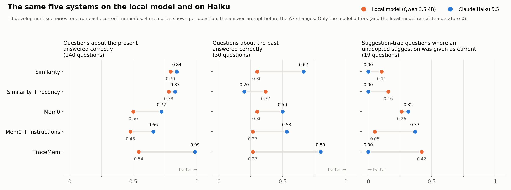

# The five systems on the local model and on Claude Haiku

The chart compares two runs of the five systems on the 13 development scenarios. Only the model differs between the two runs: the local model is Qwen 3.5 4B (run at temperature 0), and the other model is Claude Haiku 5.5. Both runs used one run per system, the correct-memories condition, 4 memories shown per question, a reply limit of 1,024 tokens, and the answer prompt from before the A7 changes (hash `b6571cd57e4e`). The local run is `runs/a7/base/` and the Haiku run is `runs/a7/haiku/` on A's machine; both are single runs, so differences of a few questions are within the variation between repeated runs.

| System | Present, local | Present, Haiku | Past, local | Past, Haiku | Suggestion given as current, local | Suggestion given as current, Haiku |
|---|---|---|---|---|---|---|
| Similarity | 0.79 | 0.84 | 0.30 | 0.67 | 0.11 | 0.00 |
| Similarity + recency | 0.78 | 0.83 | 0.37 | 0.20 | 0.16 | 0.00 |
| Mem0 | 0.50 | 0.72 | 0.30 | 0.50 | 0.26 | 0.32 |
| Mem0 + instructions | 0.48 | 0.66 | 0.27 | 0.53 | 0.05 | 0.37 |
| TraceMem | 0.54 | 0.99 | 0.27 | 0.80 | 0.42 | 0.00 |

"Present" is the share of the 140 questions about the present answered correctly. "Past" is the share of the 30 questions about earlier states answered correctly. "Suggestion given as current" is the share of the 19 suggestion-trap questions where the system gave a suggestion that nobody adopted as the current value; lower is better.

**Most of TraceMem's failures on the local model came from the model, not from TraceMem's design.** TraceMem's resolver, which decides what each new statement does to memory, chose the expected operation for 55 of 121 statements on the local model and for 117 of 121 on Haiku. TraceMem's share of correct answers about the present went from 0.54 on the local model to 0.99 on Haiku.

## The deck's frozen settings

The three folders below come from the A7 run at the settings frozen as `freeze-deck` (27 Oct, 00:01 to 00:17): the answer prompt after the A7 changes, a reply limit of 2,048 tokens, and otherwise the settings above. For each system they hold the memory after each meeting, every model input and reply, and the model calls made while storing statements. Each folder's README explains its files.

- [`pilot-01/`](pilot-01/README.md): the demo's scenario. Every system answers 12 or 13 of its 13 questions correctly, so it shows how each memory works rather than how the systems differ.
- [`dev-06/`](dev-06/README.md): the scenario that separates the systems most on these settings. TraceMem answers 14 of 14; Mem0 + instructions answers 4, because it keeps giving the old value after each switch.
- [`pilot-05/`](pilot-05/README.md): similarity, similarity + recency and TraceMem answer 9 of 9; each Mem0 system loses 3 answers that give the right model with extra words.

On the 13 development scenarios at these settings, the share of questions about the present answered correctly is 0.96 for similarity, 0.94 for similarity + recency, 0.81 for Mem0, 0.75 for Mem0 + instructions and 0.99 for TraceMem; for questions about the past it is 0.87, 0.50, 0.73, 0.60 and 1.00.

**A scoring question is open.** Of Mem0's 20 answers scored as a different value, 13 contain the expected value with extra words, such as "LightGBM on lag features" where the expected value is "LightGBM"; for Mem0 + instructions it is all 6. The other systems have none. Mem0's own memory text is wordier, and the scorer counts the extra words as a different value. Until the team decides whether such an answer should count, Mem0's scores above may be understated by up to 13 of 140 questions.
